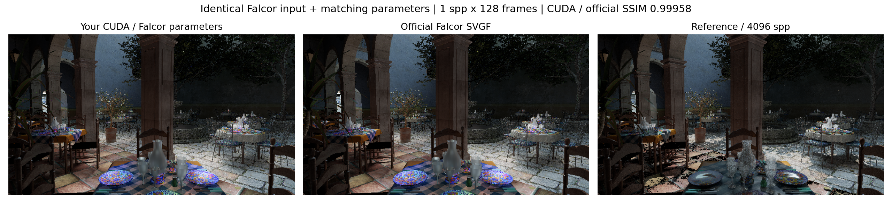
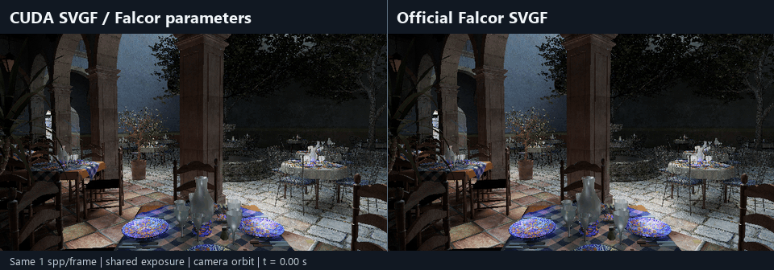
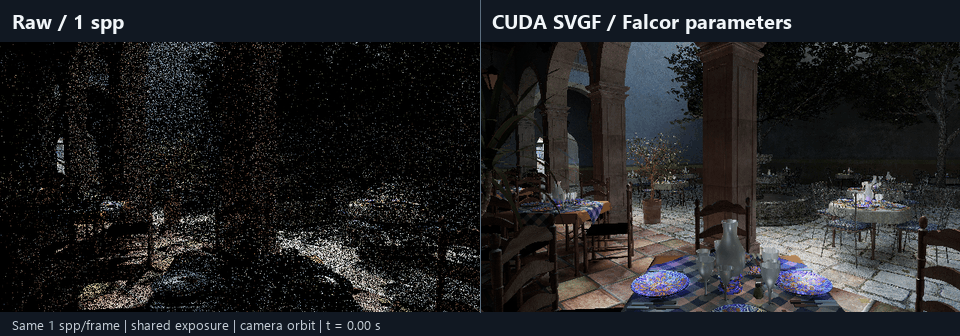

# Parameters, validation and reproduction

[Back to README](../README.md)

Run all commands below from the repository root. This document collects the
parameters, implementation notes, scene preparation, benchmark results and
reproduction instructions previously kept in the README. Historical results
retain their original parameter sets.

## Current CUDA default and official Falcor comparison

The right-hand CUDA denoiser now defaults to the same parameter set as the
official Falcor SVGF pass. The center view remains the original project
denoiser; **Falcor-aligned CUDA** means a CUDA adaptation, not Falcor itself.
The comparison below actually runs official Falcor SVGF separately and gives
both implementations identical Falcor samples and G-buffer data.

| Setting | CUDA default and official Falcor SVGF |
| --- | ---: |
| Color alpha | 0.05 |
| Moments alpha | 0.2 |
| PhiColor / luminance sigma | 10 |
| PhiNormal / normal exponent | 128 |
| A-trous iterations | 4 |
| Feedback tap | 1 |

Temporal filtering, spatial filtering and albedo demodulation are enabled.
The optional anti-lag and history-clamping stages are disabled. **Falcor
defaults** restores this configuration; **Previous SVGF preset** restores
alpha 0.2, luminance sigma 2 and feedback tap 0. This update changes parameters,
not the filtering algorithms.



This stationary San Miguel comparison uses 640x360 pixels, 128 frames at 1 spp,
identical raw input and raster guides, and one shared Reinhard+sRGB display
transform at EV +2. The reference is an independent, unfiltered 4096-sample
average from the same Falcor renderer. No TAA or DLSS is used.

| Variant | Display PSNR vs reference | Display SSIM vs reference |
| --- | ---: | ---: |
| CUDA, current Falcor-matched parameters | 21.234 dB | 0.788074 |
| Official Falcor SVGF | 21.209 dB | 0.787725 |

**Between the two denoised outputs**, display SSIM is **0.9995767** and PSNR
is **46.138 dB**. These pairwise numbers measure implementation agreement,
not accuracy against the reference. The images are close, not bitwise equal.
Both still over-smooth some bottle/cup highlights and leave background noise.
This static comparison does not establish identical motion or disocclusion
behavior, or reproduction of the paper's original lighting and materials.

[Inspect the enlarged crops](../img/svgf-falcor-matched-crops.png).
The full local outputs are under `build/svgf-official-parameters`, including
`comparison.png`, `crops.png`, `before-after.png`, `cuda-settings.json` and
`metrics.json`. The complete recorded input and exact raster guides match the
earlier capture bitwise; fresh official SVGF checkpoints also match bitwise.
The rebuilt CUDA default and explicit Falcor preset produce identical output.
Release builds and both existing CTest checks pass.

To repeat using the existing shared-input dataset and independent reference:

```powershell
.\tools\run-falcor-shared.ps1 -ReferenceSamples 0 -OutputDirectory build/svgf-official-parameters
.\build\audit-env\Scripts\python.exe tools/compare_svgf_matched.py build/svgf-official-parameters
```

This requires the Falcor build, courtyard assets, analysis environment and
`build/falcor-shared-final` dataset described in
[Shared Falcor input](#shared-falcor-input-official-svgf-cuda-svgf-and-nrd).
The zero-reference capture above reuses the existing independent reference;
it does not generate a new one. Scene downloads, build products and full float
captures are excluded from Git; selected comparison images and animations are
included under `img/` for viewing the README without the local build directory.

### Camera-motion comparison



Left: this project's CUDA denoiser with Falcor parameters. Right: official
Falcor SVGF. These are actual moving-camera renders with per-frame camera,
world position, normal, albedo, emission and raster derivative data; the images
are not still captures moved or interpolated by a video editor. Both filters
consume the same 1 spp input and use the same exposure and display transform.

The 6-degree camera orbit also moves vertically by 0.16 m; scene geometry and
lighting stay static. After 48 stationary warmup frames, 240 moving frames are
rendered on a fixed 60 Hz timeline. Every third frame is shown at 20 fps,
giving an 80-frame, 4-second loop. Playback fps is not a rendering-throughput
measurement. Neither filter resets history during camera movement.

For these moving frames, mean pairwise display SSIM is **0.9669**, evaluated
at the native 640x360 resolution before GIF encoding. The implementations
therefore differ more during this orbit than in the static comparison above.
This is output agreement, not accuracy against a clean moving reference;
no per-frame high-sample reference or temporal-quality ranking is claimed.

[Watch the MP4 comparison](../img/svgf-falcor-motion.mp4) to avoid GIF's 256-color
palette limit. The README animations show each view at 480x270 inside a
960x336 labeled frame. Full float captures, camera trajectory, raw-input
hashes, history diagnostics and `animation-verification.json` are kept under
`build/falcor-motion`. Falcor export and CUDA replay have identical RGB SHA-256;
the final CUDA history has a mean length of 26.2 frames, confirming that history
is reused rather than cleared on every camera update.

Reproduce on Windows after building Falcor and downloading San Miguel:

```powershell
.\build\audit-env\Scripts\python.exe -m pip install -r tools/animation-requirements.txt
cmake -S . -B build -DPATH_TRACER_BUILD_TESTS=ON
cmake --build build --config Release --target falcor_motion_replay --parallel 8
.\tools\run-falcor-motion.ps1
.\build\audit-env\Scripts\python.exe tools/make_motion_gifs.py build/falcor-motion
```

## Moving courtyard denoising demo



Left: raw 1 spp. Right: the current CUDA SVGF output, using the same motion
sequence as the comparison above. Falcor supplies the path-traced input in
this demo; denoising on the right is performed by this project's CUDA code.
[MP4 version](../img/courtyard-denoising.mp4).

<details>
<summary>Original Cornell box project demo</summary>

The original demo is preserved here for historical context.


</details>

## Path Tracing
The project is developed based on [CIS 565 Project 3](https://github.com/ZheyuanXie/Project3-CUDA-Path-Tracer). Addtion to the project 3, we implemented texture mapping and bounding volume hierarchy to accelerate path tracing for complex meshes. To reduce sample variance, if the ray hit matte surface, we trace a shadow ray directly to the light.

## Denoising - Spatiotemporal Method


### Temporal Accumulation
To reuse samples from the previous frame, we reproject each pixel sample to its prior frame and calculate its screen space coordinate. This is completed in the following steps:
1. Find world space position of the current frame in G-buffer. 
2. Transform from current world space to the previous clip space using the stored camera view matrix.
3. Transform from previous clip space to previous screen space using perspective projection.

For each reprojected sample we test its consistency by comparing current and previous G-buffer data (normals, positions, object IDs). If the test rejects, we discard the color and moment history of the corresponding pixel and set history length to zero.

### Spatial Filtering
The spatial filtering is accomplished by a-trous wavelet transform. As illustrated in the figure below, the a-trous wavelet transfrom hierarchically filters over multiple iterations with increasing kernel size but a constant number of non-zero elements. By inserting zeros between non-zero kernel weights, computational time does not increase quadratically.


A set of edge stopping functions prevent the filter from overblurring important details. Three edge-stopping functions based on position, normal, and luminance are used as in *Edge-avoiding À-Trous wavelet transform for fast global illumination filtering*  [Dammertz et al. 2010]. The standard deviation term in luminance edge-stopping function is based on variance estimation. This will guide the filter to blur more in regions with more uncertainty, i.e. large variance.

## Build Instruction

Windows requirements: Visual Studio 2022 with Desktop development with C++,
CMake 3.24 or newer, and CUDA Toolkit 12.9 with Visual Studio integration.
The bundled GLFW, GLEW, GLM, stb, ImGui, and tinyobjloader dependencies are used.
Verified with VS 2022 17.13, CMake 3.30.6, CUDA 12.9, and an RTX 5070 Ti.

Run these commands in PowerShell from the repository root:

```powershell
cmake -S . -B build -G "Visual Studio 17 2022" -A x64
cmake --build build --config Release --parallel
.\run.ps1
```

The launcher opens `scenes/cornell.txt` by default. Select another scene with
`.\run.ps1 -Scene bunny` (also available: `diamond`, `room`), or supply a scene
file path. To launch the executable directly from the repository root:

```powershell
.\build\bin\Release\cis565_path_tracer.exe .\scenes\cornell.txt
```

CMake targets the installed GPU by default. For a different target GPU, set
`-DCMAKE_CUDA_ARCHITECTURES=<compute capability>` when configuring (for example,
`120` for an RTX 5070 Ti). The generated Visual Studio solution also sets the
renderer as the startup project and supplies the Cornell scene for debugging.

CUDA/OpenGL interop is used when both APIs run on the same GPU. On hybrid
graphics systems, CUDA renders on NVIDIA and transfers the preview through host
memory to the display GPU. This adds a per-frame transfer but requires no changes
to Windows graphics settings. Models and textures are resolved relative to the
scene file, so launching from another working directory is supported.

The preview contains three labeled views, with a separate control sidebar:

| Left | Center | Right |
| --- | --- | --- |
| Raw / 1 spp | Original denoiser | SVGF (Falcor-aligned CUDA) |

Both denoisers are enabled by default, have independent history, and derive their
inputs from the same path-traced sample. The original implementation remains in
`src/denoise.cu`. Its **All** and **None** buttons affect the center view; disabling
it restores its original progressive accumulation behavior. The raw view always
shows the current sample. The right view has its own temporal/spatial controls,
albedo preservation, alpha, luminance threshold, filter levels, and history reset.
All three views use the same exposure and display conversion. **Display** now
provides a shared Reinhard tone map, sRGB output transfer and exposure control.
This is the default for previews and PNG export. Disable **Tone map + sRGB**
(or use `--display legacy`) to inspect the former linear-clipped display.
Linear float captures are always saved before this display transform.

The new implementation in `src/denoise_optimized.cu` uses correctly normalized,
double-buffered variance propagation, consistent moment accumulation, partial
bilinear history reuse with geometry rejection, a 7x7 short-history illumination
and moment prefilter, and wavelet steps starting at 1. It demodulates/remodulates
surface albedo to preserve texture detail and bypasses primary emission. Its
default geometric edge stopper uses linear-depth derivatives scaled by kernel
distance and wavelet step; it is a practical SVGF adaptation rather
than a complete reproduction of the paper (for example, direct/indirect light
are not filtered separately and there is no final TAA pass).

The right view now defaults to **Falcor's public SVGF parameters** on the
Falcor-aligned CUDA stages: color alpha 0.05, moments alpha 0.2, luminance
sigma 10, normal exponent 128, four levels, feedback tap 1. **Falcor defaults**
restores these settings. **Previous SVGF preset** restores the former locally
evaluated settings (alpha 0.2, luminance sigma 2, feedback tap 0).
**Previous CUDA** restores the older algorithm/preset. Historical comparison
tables below retain the settings used when those captures were generated.
**Adaptive** enables the experimental responsive stage on the new core.
Use `run.ps1 -Denoiser svgf|previous|falcor|adaptive` or the executable's
`--denoiser` option to select a mode. The responsive version adds an independent fast history, a 5x5
geometry-aware YCoCg statistical color box, noise-aware history acceleration,
history-length reduction, and moment correction after color adjustments.
**Anti-lag**, **History clamp**, **Fast history**, **Clamp sigma**, and **Anti-lag
strength** can be adjusted independently. Debug views show history length or
anti-lag reaction (red = stronger reaction). These display modes do not change
the history fed into subsequent frames. Settings changes reset only the right
view's history.

In **Ray Tracing**, enable **Pulse light (anti-lag test)** to alternate all emitted
light between 100% and 5% every 90 traced frames without resetting either
denoiser. This isolates lighting lag while all panels share the same input.

Relevant follow-up work:

- [Schied, Peters, Dachsbacher: Gradient Estimation for Real-Time Adaptive Temporal
  Filtering (2018), A-SVGF](https://momentsingraphics.de/Media/HPG2018/Schied2018-AdaptiveTemporalFiltering.pdf)
  estimates temporal shading gradients by re-evaluating forward-projected surface
  samples with the same random sequence. It adapts accumulation to lighting
  changes. The current implementation does **not** implement this gradient
  estimator or random-sequence replay and should not be presented as A-SVGF.
- [NVIDIA NRD / RELAX](https://github.com/NVIDIA-RTX/NRD) uses an A-trous pipeline
  with fast history and anti-lag mechanisms. Its public
  [settings](https://github.com/NVIDIA-RTX/NRD/blob/master/Include/NRDSettings.h)
  and [history-clamping pass](https://github.com/NVIDIA-RTX/NRD/blob/master/Shaders/RELAX_HistoryClamping.cs.hlsl)
  describe the relevant concepts. Our CUDA code is an independent, simplified
  implementation of these ideas; that CUDA path does not call NRD. It combines
  diffuse/specular radiance and lacks roughness/hit-distance inputs and
  specialized specular reprojection. The separate Falcor comparison adapters
  below do execute the official NRD 3.1 and 4.18 libraries.

In deterministic synthetic tests (48x24 pixels, alpha 0.1, five spatial levels,
three-frame fast history, clamp sigma 2, 32 warm-up frames, measuring the
first 6 frames after a lighting switch), adaptive/baseline transient RGB MSE was
0.0690; for an equal-luminance color switch it was 0.0725. The stationary noisy
field MSE ratio was 1.0060. These are narrow regression checks, not full scene
quality or performance benchmarks. Sparse bright samples, glossy reflections,
and rapidly moving geometry still require scene-specific evaluation.

Press **H** to hide the panel, **S** to save a PNG, and **Esc** to save and exit.
The saved PNG currently contains the original denoiser's center view.
Use the arrow keys to move the camera and the mouse buttons to orbit or pan.
Press **A** (or select **Camera > Automate Camera Motion(A)**) to start/stop a
gentle automatic orbit from the current view, like the original animated demo.
The default angular speeds are nonzero. Motion is time-based and relative to
the current camera/target, so it also works in Bistro instead of jumping to the
original Cornell-only coordinates. Mouse dragging or manual camera navigation
takes control; **Z** restores the scene camera and stops automatic motion.
The existing camera speed sliders control the oscillation phase speeds in
radians per second; zero freezes the corresponding component.

Start directly with camera animation using `.\run.ps1 -Scene bistro -AutoCamera`,
or append `--auto-camera` when launching the executable directly.

## Official Falcor courtyard demo

The official NVIDIA Falcor framework has also been cloned, built and run
separately from this CUDA renderer. The working version on this machine is
[Falcor 8.0, commit 9dc819c](https://github.com/NVIDIAGameWorks/Falcor/tree/9dc819c162b2070335c65060436041690b7937f8),
under `build/Falcor8`. Its renderer and SVGF sources are unmodified. Falcor 9.0
compiled, but D3D12 device creation failed on this setup; its Vulkan backend
could create a device but did not provide the ROV support required by
`GBufferRaster`. The 8.0 build runs on the RTX 5070 Ti using D3D12 / SM6.7.

Open the interactive comparison:

```powershell
.\tools\run-falcor-courtyard.ps1
```

Use `-Build` to reproduce the official checkout/dependency download and Release
build, or `-Headless` to render, capture and exit. `-Width`, `-Height`, `-Gpu`,
`-CaptureFrames`, `-ExposureEV` and `-EnvironmentIntensity` configure the demo.
The launcher requires the San Miguel assets prepared earlier and Visual Studio
2022 / a Windows SDK when building. It restores its temporary environment
variables after the application exits.

`scenes/falcor_san_miguel.pyscene` imports the original real-time OBJ/MTL through
Falcor's native Assimp importer, including the available specular parameters,
texture maps and opacity-to-transmission handling. It uses a demonstration
camera, a warm directional sun and the HDR environment bundled with Falcor's
Arcade scene. The current default is environment intensity 8 and shared exposure
compensation +2 EV. These are demo lighting settings, not the original paper's
camera or illumination.

`tools/falcor_courtyard.py` wires the official `GBufferRaster`, `PathTracer` and
`SVGFPass` following Falcor's own SVGF test graph. The path tracer uses 1 spp per
frame, NEE/MIS, up to six surface bounces and three diffuse bounces. No progressive
accumulation pass is used for the noisy branch. The very same path-traced color
feeds official SVGF with its default four iterations, feedback tap 1, alpha
0.05, moments alpha 0.2 and luminance phi 10. Both branches use identical ACES
exposure and sRGB output. The interactive split view shows raw on the left and
SVGF on the right; the full-frame outputs remain available separately.

Captures at frames 1, 64 and 128, plus linear EXRs and run metadata, are in
`build/falcor-demo`. The SVGF result uses temporal history; "1 spp" denotes the
per-frame input budget, not an absence of temporal reuse. Generate labeled
full-frame comparisons and convenient PNG copies with:

```powershell
.\tools\run-falcor-courtyard.ps1 -Headless
.\build\audit-env\Scripts\python.exe tools/falcor_preview.py build/falcor-demo
```

The files `falcor-raw-1spp.png`, `falcor-official-svgf.png` and
`falcor-comparison.png` contain the two native captures and their labeled
comparison. The labeling script applies no additional color adjustments.

## Shared Falcor input: official SVGF, CUDA SVGF and NRD

`tools/run-falcor-shared.ps1` runs a **single official Falcor 8 PathTracer**
and exports its unbounded float RGB sequence and stationary raster G-buffer.
Official `SVGFPass` runs in that same graph. `falcor_replay` runs the current
CUDA denoiser on those exact samples, first with the compiled default parameters,
then with explicitly assigned Falcor parameters. These now match; the archived
results below predate the default change. Neither preset is fitted to this scene's
reference. The export supplies exact raster depth, depth derivative and normal
filter width to CUDA through an optional guide input; normal application runs
continue to compute their own guides.

The same graph actually calls **NRD 3.1.0 RELAX**, the SDK bundled with Falcor 8,
including the diffuse/specular and delta reflection/transmission paths. This is
not NRD 4.18/current master. NRD receives additional roughness, separated path
contributions and hit distances from the same tracing invocation. No DLSS, TAA,
or pre-accumulation is enabled. `SharedInputGuides` is our input-format adapter;
the official PathTracer, SVGFPass and NRD denoiser implementations are unchanged.
Only the adapter and its CMake subdirectory are added to the local Falcor checkout.

Falcor 8's default NRD demodulation did not reconstruct raw RGB correctly on this
imported transmissive scene: the per-sample and guide-path delta reflectances
could disagree. That diagnostic run is excluded from the final comparison.
The final graph disables Falcor's per-sample NRD demodulation, normalizes primary
diffuse/specular signals with deterministic raster material factors, and uses
the exact same factors to remodulate. Delta channels stay unmodulated. The raw
lobe sum reconstructs the original RGB exactly at all four captured checkpoints.
Falcor's NRD packing still applies its intensity limit of 250 to demodulated
inputs; this is NRD-specific preprocessing, not a shared input modification.
The NRD result therefore measures this documented integration and old SDK,
not the maximum quality of the current NVIDIA NRD sample.

Reproduce after building Falcor and downloading San Miguel:

```powershell
.\tools\build-falcor-shared-plugin.ps1
cmake -S . -B build -DPATH_TRACER_BUILD_TESTS=ON
cmake --build build --config Release --target falcor_replay --parallel 8
.\tools\run-falcor-shared.ps1
```

The comparison script uses `build/audit-env/Scripts/python.exe`, with numpy,
Pillow, matplotlib and scikit-image installed. It validates the raw sequence
SHA-256 and bitwise identity with Falcor's saved noisy image. All outputs use
one Reinhard+sRGB display transform at EV +2. The default capture uses 640x360,
128 frames at 1 spp, a stationary camera without pixel jitter, and a separate
4096-sample unfiltered reference (subsequent samples 129..4224). This tests static
reconstruction, not motion quality, disocclusions or flicker.

Final artifacts: `build/falcor-shared-final/comparison.png`, `crops.png`,
`all-variants.png`, individual full-size PNGs, float outputs, `metrics.json`,
`run.json`, and `stationary.seq`. The following is the **historical capture
before the CUDA defaults were changed**; its first row is the previous preset:

| Variant | Linear MSE | Display PSNR | Display SSIM |
|---|---:|---:|---:|
| CUDA previous preset (alpha 0.2, PhiColor 2, tap 0) | 0.0113788 | 23.02 dB | 0.7529 |
| Official Falcor SVGF | 0.0342205 | 21.21 dB | 0.7877 |
| CUDA with Falcor parameters | 0.0329575 | 21.23 dB | 0.7881 |
| NRD 3.1 RELAX integration | 0.0027359 | 20.00 dB | 0.6086 |

Matched CUDA/official outputs have pairwise display SSIM **0.99958** and PSNR
**46.14 dB**; they are close, not bitwise identical implementations. The previous
CUDA preset had better displayed PSNR but lower SSIM than official defaults.
NRD lowers linear-domain error while losing detail and showing artifacts here;
these metrics do not establish an overall winner. The split-reference estimate
of full-reference noise MSE is 0.00009057, and glossy regions remain noisy.
CUDA replay averages about 1.01 ms per frame on this RTX 5070 Ti, excluding
upload/readback; no comparative official/NRD GPU timings are claimed.

The external-guide edge stopping test passes along with existing numerical and
import tests. Compute Sanitizer reports zero errors for the full 128-frame
shared-input CUDA replay.

### NRD 4.18 on the same frozen Falcor input

The follow-up actually builds and executes **NRD 4.18.0** from official commit
`90dea8bd91ec6b58d0f90cb6adf53c7da613b82c` (header dated 9 October 2026).
`tools/falcor_nrd4_plugin` is a D3D12 dispatch adapter for the SDK's embedded,
official DXIL binaries. It does not translate or reimplement the NRD kernels.
The runtime checks version and normal/roughness encoding. Its DLL is copied as
`NRD4.dll` and loaded explicitly, leaving Falcor's old NRD 3.1 DLL intact.
Build configuration is DXIL only, normal encoding 2 (R10G10B10A2), roughness
encoding 1 (linear), with the SDK's other default feature switches.

```powershell
.\tools\build-falcor-nrd4.ps1 -BuildSDK
.\tools\run-falcor-nrd4.ps1 -DebugLayer
```

This consumes the previous run's `build/falcor-shared-final/stationary.seq` as
a byte-for-byte assertion target. Every one of the newly rendered 128 RGB
frames must match it; all saved official SVGF checkpoints and the initial
position, normal, albedo, emission, depth and derivative arrays must also match.
The raw sequence SHA-256 remains
`97f20b0f776129d64c891488f7d6e3e451bbffbea73be44b86e9544e315e0410`.
The archived CUDA output (the previous alpha 0.2 / PhiColor 2 preset) and
independent 4096 spp reference are reused directly. The current default's
Falcor-matched comparison is shown at the top of this README.

`prepare_nrd4_metadata.py` writes an auxiliary-alpha-only adaptation of Falcor's
runtime `ResolvePass.cs.slang`: per-lobe sampled distances, with zero for skipped
lobes, instead of copying one distance to both lobes. It does not alter RGB or
the path sampler. Official checkout source shaders are left unchanged; the
generated runtime patch and hashes are recorded in `build/nrd4-metadata-patch.json`.
The NRD4 launcher restores the original runtime shader on exit, so old NRD 3.1
launches keep their original convention. Always use the NRD4 launcher for this
experiment; it applies the auxiliary adaptation only for that run.

Primary diffuse/specular signals now use the actual NRD 4.18
`NRD_MaterialFactors`, normal packing, RELAX front-end packing and back-end
unpacking helpers. The same material factors are used for remodulation.
There is one RELAX_DIFFUSE_SPECULAR primary instance and two independent
RELAX_DIFFUSE secondary instances. Settings use 30-frame main / 6-frame fast
history, default 30/50-pixel prepasses, AREA_5X5 distance reconstruction, and
material comparison for pixels with/without diffuse reflectance. No tuning
against the reference, TAA, DLSS, or radiance caching is used.

Outputs are under `build/falcor-nrd4`: `comparison.png`, `crops.png`,
`all-variants.png` (also includes the previous 3.1 integration), individual PNGs,
float arrays, `run.json` and `metrics.json`. The archived figure and results use
the previous CUDA preset, not the subsequently changed application default:

| Variant | Linear MSE | Display PSNR | Display SSIM |
|---|---:|---:|---:|
| CUDA previous preset (alpha 0.2, PhiColor 2, tap 0) | 0.0113788 | 23.02 dB | 0.7529 |
| Official Falcor SVGF | 0.0342205 | 21.21 dB | 0.7877 |
| NRD 4.18 RELAX integration | 0.0034854 | 23.33 dB | 0.7693 |

These are **integration results on the inherited Falcor samples**, not a
claim to reproduce the NRD-Sample's best quality. Two material limitations:

* Preserving the old Falcor input also preserves its random primary-lobe
  selection. The sample's Bayer coverage and probability bounds are not
  guaranteed. AREA_5X5 reconstruction helps but cannot create absent samples.
* Existing secondary guides do not implement full NRD-Sample PSR, virtual
  normals or curvature-aware distances. In the captured final frame, **all
  delta-transmission contributions lack a valid secondary guide** and are
  explicitly passed through unfiltered. Roughly 1.26% of the reflection-layer
  RGB energy also uses that fallback. The remaining bottle/cup noise must not
  be presented as a measured failure of correctly guided NRD transmission.

The D3D12 debug-layer run completes with no reported D3D12 errors, and all
captured float outputs are finite. The repeat run in
`build/falcor-nrd4-verified` preserves the same RGB hash and official SVGF output.
The old 3.1 and new 4.18 adapters also differ in material factors, lobe-distance
metadata and clamping, so that pair is not a controlled library-version-only A/B.

## Reproducible SVGF quality audit

This is the earlier audit of this project's **own CUDA renderer**, not the
same-input Falcor comparison above. Its historical tables use the selected
alpha 0.2 / PhiColor 2 / feedback tap 0 preset. The audit script's
`--denoiser svgf` now selects the new Falcor-matched application default, so rerunning it
does not reproduce those old parameter-dependent numbers unchanged.

The CUDA stages were checked against NVIDIA's
[Falcor SVGFPass, pinned to tag 9.0 / commit 759aad0](https://github.com/NVIDIAGameWorks/Falcor/tree/759aad033ff610fb0d82c74f7e0a508d0096d5f2/Source/RenderPasses/SVGFPass).
Adapted portions retain the NVIDIA notice in
`third_party/Falcor-SVGF-LICENSE.txt`. The unmaintained prototype download
returned HTTP 406 during this audit; the pinned official Falcor sources were
used instead. The downloaded inspection copies are under `build/official-svgf`.

The audit found these differences in the previous CUDA implementation:

| Stage | Previous CUDA | Current aligned stages |
| --- | --- | --- |
| Temporal moments | Same alpha as color | Independent moments alpha |
| Short history | Estimate variance from neighboring filtered colors | Filter illumination and accumulated moments together; variance boost `4 / history` |
| Spatial geometry | Fixed depth-relative tangent-plane tolerance | Linear-depth finite differences, scaled by kernel distance and wavelet step |
| History validation | Fixed normal cutoff | Normal finite-difference tolerance, previous-camera depth check, additional world-space footprint bound |
| Feedback | First wavelet level | Configurable tap; current default 1, historical selected preset 0 |
| Primary emission | Mixed into filtered illumination | Subtracted before filtering and restored afterward |

The short-history and emission paths have numerical regression tests, alongside
the prior tests for variance, reprojection, disocclusion and adaptive lighting.
Finite differences approximate rasterizer derivatives using 2x2 primary-ray
quads. This is not bit-for-bit Falcor: rasterized motion/derivative inputs,
full material handling, jittered primary visibility and final TAA are absent.

`scenes/san-miguel-benchmark.txt` fixes a tabletop camera for controlled tests.
`--reference N` renders an unfiltered average of N independent path samples per
pixel. Two equal-size reference runs with seed offsets 100000 and 200000 are
averaged for evaluation. They are independent of the denoiser's input sequence.
PFM captures retain unclipped float32 linear radiance. The recorded primary rays
are fixed at pixel centers; this reference measures convergence of this renderer,
not the physically correct ground truth or NVIDIA's renderer.

Create the local analysis environment once:

```powershell
python -m venv --system-site-packages build/audit-env
.\build\audit-env\Scripts\python.exe -m pip install -r tools/audit-requirements.txt
```

Build with `-DPATH_TRACER_BUILD_TESTS=ON`, then run the complete static and
camera-motion audit (two 1024 spp halves give a 2048 spp reference):

```powershell
.\tools\run-svgf-audit.ps1 -Motion
# Also record a stationary input sequence and evaluate the parameter grid:
.\tools\run-svgf-audit.ps1 -Replay
```

The script writes linear images, camera metadata, per-stage captures, metric
JSON, logs and side-by-side figures under `build/svgf-audit-reproduced` by
default. Motion uses a fixed 1/60-second timestep, then renders a stationary
high-spp reference at the captured final camera pose. This measures final-frame
reconstruction during motion; it is not a full temporal flicker metric.
`tools/make_pose_scene.py` preserves absolute imported mesh paths when creating
that frozen-pose scene.

The evaluator checks that before/after raw inputs agree, reports unclipped
linear MSE/relative RMSE, and computes display PSNR/SSIM using the same Reinhard
and sRGB transform for every image. The difference between independent reference
halves estimates the remaining noise of their average. Per-stage illumination
captures are remodulated with the captured albedo/emission before comparison.

For individual runs:

```powershell
.\build\bin\Release\cis565_path_tracer.exe scenes/san-miguel-benchmark.txt --hidden --no-vsync --frames 128 --denoiser svgf --capture build/audit/after
.\build\bin\Release\cis565_path_tracer.exe scenes/san-miguel-benchmark.txt --hidden --no-vsync --reference 2048 --seed-offset 100000 --capture build/audit/reference
```

`--record FILE` saves stationary raw samples and geometry for `denoise_replay`;
it requires `--hidden --frames` and rejects camera automation. The binary
sequence is a local, versioned benchmark format checked against the camera and
G-buffer structure sizes of the current build. Re-record after layout changes.
The replay target evaluates identical samples without repeatedly loading the
scene or retracing rays. Its parameter grid is an exploratory diagnostic, not
evidence of generalization; use a separate scene/camera to validate a selection.
Diagnostic captures and sequence recording add CPU synchronization/I/O, so their
timings should not be used as normal rendering performance measurements.

Local audit results on RTX 5070 Ti, 128 input frames, comparing the former right
panel against the selected aligned preset:

| Case | Reference samples | Linear MSE reduction | Display PSNR, before → after | Display SSIM, before → after |
| --- | ---: | ---: | ---: | ---: |
| San Miguel tabletop, stationary (selection case), 640x360 | 2048 | 42.6% | 27.40 → 29.99 dB | 0.8664 → 0.8979 |
| San Miguel tabletop, moving camera, final frame, 640x360 | 2048 | 45.8% | 26.49 → 29.53 dB | 0.8469 → 0.8870 |
| Bistro, stationary holdout, 600x600 | 1024 | 25.1% | 32.63 → 34.05 dB | 0.9356 → 0.9467 |

The final-frame raw inputs were byte-identical in all three comparisons. The
estimated reference noise MSEs were 1.06e-5, 1.11e-5 and 6.09e-5, respectively.
Files are under `build/svgf-audit` and `build/svgf-audit-bistro`; each directory
contains metric JSON and comparison/error-map PNGs. These measurements do not
establish equivalence to NVIDIA's images or broad scene-independent superiority.

An ablation on the identical recorded San Miguel sequence separates the sources
of improvement (unclipped linear MSE):

| Variant | MSE |
| --- | ---: |
| Previous right panel including its responsive stage | 0.00114439 |
| Previous core with responsive stage disabled | 0.00090362 |
| Previous core with the selected parameters, responsive stage disabled | 0.00071018 |
| Aligned core with the same selected parameters | 0.00065713 |
| Aligned core with Falcor's default parameters | 0.00167969 |

Thus the total improvement is from disabling a heuristic that hurt this static
case, selecting less aggressive spatial filtering, and correcting/adapting the
core stages. It should not all be attributed to the core changes alone.
For the recorded dataset in this workspace, reproduce the ablation with:

```powershell
.\build\bin\Release\denoise_replay.exe build/svgf-audit/stationary.seq build/svgf-audit/ref-a-reference.pfm build/svgf-audit/ref-b-reference.pfm build/svgf-audit/ablation --ablation-only
```

## San Miguel courtyard (SVGF paper scene)

The San Miguel courtyard shown in the SVGF paper is available from
[Morgan McGuire's Computer Graphics Archive](https://casual-effects.com/data/).
The [downloaded package](https://casual-effects.com/g3d/data10/research/model/San_Miguel/San_Miguel.zip)
contains both full and real-time OBJ variants, materials, PNG textures, and
`license.txt`. The bundled license grants research and educational use with
attribution to Guillermo M. Leal Llaguno and the archive contributors; retain
that license when using these assets.

The assets on this machine are already prepared. Launch the stationary camera
first, then press **A** to compare behavior during motion:

```powershell
.\run.ps1 -Scene san-miguel
# Or start with the camera moving:
.\run.ps1 -Scene san-miguel -AutoCamera
```

To download and prepare the scene on another machine (Python with Pillow, no
Blender required):

```powershell
.\tools\download-san-miguel.ps1
```

The preparation script validates the downloaded archive's SHA256, uses the
real-time mesh, writes triangle fans explicitly, removes repeated references to
the same material library, and caps RGBA base-color textures at 1024 pixels.
The full source assets remain in `scenes/Models/san-miguel/source`; generated
assets live in `converted`. Both directories and the download are ignored by
Git. `tools/prepare_san_miguel.py --full` selects the larger source mesh when
invoked with the source and destination directories.

The loaded scene has 5,617,451 triangles, 282 materials including the test light,
and 219 base-color textures. Its initial camera looks along the arcade past a
table toward the fountain. Resolution is 640x360 per view. A warm sphere above
the courtyard provides test lighting; `SKY r g b` in the camera block adds constant environment
radiance on missed paths, including diffuse continuations. The default sky is
black for existing scene configurations.

San Miguel exposed a legacy OBJ-loader bug: `usemtl` can flush faces into a shape
before an immediately following `g`/`o` or end of file. The loader previously
discarded that shape when no further faces were pending. The fix preserves
already-emitted indices, restoring 285,776 missing triangles in this scene.
The import regression fixture covers a material change followed by a group
change and a trailing material declaration.

This scene configuration does not reproduce the paper's exact camera,
illumination, renderer or reconstruction quality. Materials currently evaluate
base color and cutout alpha; glossy/transmissive BRDFs and normal/roughness maps
are not fully imported. Residual noise and flicker on foliage/thin geometry in
the right panel still need image-quality evaluation. Downloading the same scene
does not resolve those denoising limitations.

## NVIDIA ORCA Bistro scene

The project now includes a scene configuration for the interior of
[Amazon Lumberyard Bistro, NVIDIA ORCA](https://developer.nvidia.com/orca/amazon-lumberyard-bistro).
The original geometry and textures are licensed under CC BY 4.0, copyright
Amazon Lumberyard (2017). The downloaded package retains its original LICENSE,
README, source FBX, Falcor configurations and DDS textures. The local converted
assets are excluded from Git because of their size.

On this machine the assets have already been downloaded and converted. Run:

```powershell
.\run.ps1 -Scene bistro
```

To reproduce asset preparation on another machine, install Blender 4.5 and Python
with Pillow, then run (use `-Blender` if its executable is installed elsewhere):

```powershell
.\tools\download-bistro.ps1
```

The script downloads the official Bistro v5.2 package, verifies its SHA256,
exports the interior FBX to triangulated OBJ/MTL, and converts base-color DDS
textures to RGBA PNGs capped at 1024 pixels. It preserves material assignments,
UVs, vertex normals and opacity masks. `material -1` in a mesh's scene definition
opts into OBJ/MTL material import. Explicit material IDs keep the previous
material-override behavior for existing scenes.

The converted interior loads 1,043,077 triangles, 72 materials (including the
test light) and 70 base-color textures. In a short test on the RTX 5070 Ti with
AMD OpenGL display staging, load time was about 3 seconds and rendering about
4 FPS before the traversal acceleration described below, at 600x600 per view,
depth 4, with both denoisers active. This includes all
three views and is not a ray-tracing-only performance measurement.

This is a renderer adaptation, not a reproduction of the full Falcor PBR scene:
roughness/metalness and normal maps are retained in the source package but not
evaluated by the current shading model; glass is not a full transmissive PBR
material. A warm test softbox is added near the source camera so the three
denoisers can be compared under the same lighting. Original Falcor light and
environment settings are not imported. The first-triangle-hit and mesh material
mapping use a single shared BVH traversal rather than traversing it per object.

For repeatable runs and a PNG containing all three views, use a finite frame
count (`--output` is a filename base; `.png` is appended):

```powershell
.\build\bin\Release\cis565_path_tracer.exe scenes/bistro.txt --hidden --frames 32 --output build/bistro-comparison
```

`--hidden` still creates an OpenGL context and requires an interactive graphics
session. Omit it for a visible run. The renderer prints loading counts and the
average FPS when it exits.

### Performance work on the CUDA tracer

The first measured bottleneck was ray traversal, not either denoiser. The
accelerated path now uses closest-distance BVH pruning, bounded any-hit shadow
queries, a 48-byte intersection-only triangle cache with precomputed edges, and
deferred normal/UV interpolation. Opacity masks are still tested before accepting
a hit. The cache adds about 48 MB of device memory for this interior scene.
These changes preserve the existing front-face convention and random sequence.

Scene uploads and GPU allocations now survive denoiser resets and camera moves.
Resetting clears history/accumulation without re-uploading geometry and textures.
Full-precision CPU readback happens when saving an image, instead of every frame.
Release builds use one end-of-render wait, with asynchronous execution failures
checked there; Debug builds retain additional synchronization for diagnostics.
The control panel shows FPS and tracing/original/optimized GPU stage timings.

Measurements on this machine, same Bistro camera, 600x600 per view, depth 4,
1 spp, all three panels, 40 rendered frames:

| Measurement | Before | After |
| --- | ---: | ---: |
| Overall FPS, including first-frame setup and PNG export | 3.85 | 26.09 |
| Tracing GPU time | 240.44 ms | 19.57 ms |
| Original denoiser GPU time | 6.52 ms | 6.47 ms |
| Adaptive denoiser GPU time | 1.91 ms | 1.88 ms |
| Display staging copy, excluding GPU render wait | 0.47 ms | 0.47 ms |

GPU stage averages exclude the first 8 frames. These are local measurements,
not guaranteed frame rates. The before/after raw panel and adaptive panel PNGs
were byte-identical. The original panel has small run-to-run differences from
its pre-existing in-place variance race, which is intentionally retained for the
original-algorithm comparison. The numerical tests additionally compare 1500
randomized closest/any-hit queries against brute force, including finite ray
segments, nonconstant shading attributes and parallel AABB rays. CUDA memcheck
reported zero errors on the accelerated Bistro run.

The renderer still uses CUDA software traversal; it does not use RTX RT cores.
Moving traversal to OptiX is a larger future change, independent of the choice
of denoiser.

SVGF's research direction did not end in 2018. Beyond the direct A-SVGF follow-up,
relevant later directions include [NRD / RELAX and REBLUR](https://github.com/NVIDIA-RTX/NRD),
[AMD FidelityFX Denoiser](https://gpuopen.com/manuals/fidelityfx_sdk/techniques/denoiser/),
[Temporally Stable Real-Time Joint Neural Denoising and Supersampling (2022)](https://doi.org/10.1145/3543870),
and [DLSS Ray Reconstruction (2023)](https://developer.nvidia.com/blog/generate-groundbreaking-ray-traced-images-with-next-generation-nvidia-dlss/).
These are related real-time reconstruction approaches, not all direct SVGF
extensions. ReSTIR is primarily a sampling/reuse technique and should not be
described as simply the next SVGF denoiser.

Optional CUDA numerical tests (requires an NVIDIA GPU):

```powershell
cmake -S . -B build -DPATH_TRACER_BUILD_TESTS=ON
cmake --build build --config Release --parallel
ctest --test-dir build -C Release --output-on-failure
```

These cover constant signals, image boundaries, albedo detail, temporal averaging,
depth disocclusion, camera-motion reprojection with a non-square/non-default
projection, background reset, noise reduction against a known flat signal,
lighting/chromatic change response, stationary noise cost, and debug views.
The scene importer test also checks multi-material OBJ/MTL loading, triangle
ownership after BVH ordering, barycentric normals, positive ray intersections,
tiled RGBA sampling and opacity.
These synthetic checks do not establish that every scene has lower error than
the original denoiser; scene-specific reference images are needed for that claim.

## Project Timeline
### Milestone 1 (Nov. 18)
 - Revised codes from hw3 to generate data for next milestone.
 - Wrote framework code based on project 3.
 - Implemented A-Trous Wavelet Transform for spatial filtering.

[MS1 Slides](../slides/MS1.pdf)
### Milestone 2 (Nov. 25)
 - Implemented texture mapping.
 - Built and tested denoising neural network for proof of concept.
 - Completed temporal accumulation and variance estimation with bugs.

[MS2 Slides](../slides/MS2.pdf)
### Milestone 3 (Dec. 2)
 - Finised all major components in SVGF, achieved real-time denoising for basic scenes.
 - Constructed complex scenes
 - Batch-generated training data for denosing nerual network.
 - Added a GUI control panel for SVGF.

[MS3 Slides](../slides/MS3.pdf)
### Final (Dec. 9)
 - Refactored path tracer, resolved bugs and optimized performance for SVGF.
 - Generated denoised images using trained network.

## Acknowledgments
 - [1] [Spatiotemporal Variance-Guided Filtering: Real-Time Reconstruction for Path-Traced Global Illumination](https://research.nvidia.com/publication/2017-07_Spatiotemporal-Variance-Guided-Filtering%3A): The SVGF part of the project is primarily implemented based on this paper.
 - [2] [Edge-avoiding À-Trous wavelet transform for fast global illumination filtering](https://dl.acm.org/citation.cfm?id=1921491): This paper with its code sample also helped a lot in the spatial filtering part.
 - [3] [Alain Galvan's Blog](https://alain.xyz/blog/raytracing-denoising): Alain's blog posts, as well as his Nov. 20 lecture talk at UPenn gave us a good overview and understanding of denosing technoligies.
 - [4] [Dear ImGui](https://github.com/ocornut/imgui): This library lets us create pretty-looking GUI with ease.
 - [5] [Kernel-Predicting Convolutional Networks for Denoising Monte Carlo Renderings](https://www.ece.ucsb.edu/~psen/Papers/SIGGRAPH17_KPCN_LoRes.pdf): The machine learning part of the project is implemented based on this paper.
